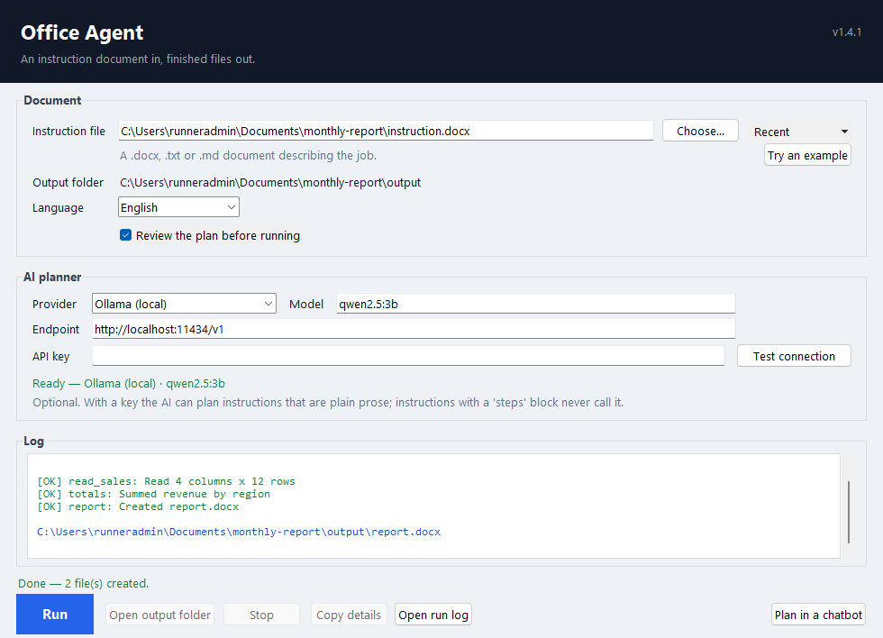

# Office automation agent

A DOCX instruction in, files out. Drop one instruction document into a job
folder, point it at your inputs, run it, and the agent builds the DOCX, XLSX,
CSV, TXT or JSON outputs the instruction describes.

The engine is deterministic: the instruction carries a small YAML/JSON job
spec, and every step names a tool action plus its arguments. Steps can pass
data to later steps with `$step.field` references, so reading a workbook,
filtering rows, summarising them and writing a report is a few declarations.

AI planning is not required: an instruction that carries a job spec never
touches the network. When an instruction is plain prose, the model can plan
it instead — set a provider once in the desktop window or on the command
line (see [AI planning](#ai-planning-optional)).

## Desktop app (single file)

If you just want to run a job without a terminal, download
[`office-agent-gui.exe`](https://github.com/2qb8/office-agent1/releases/latest/download/office-agent-gui.exe).
It is one file, needs no Python and no installation.

Every successful Windows run publishes a release for the version in
`agent/__init__.py`: both executables, `SHA256SUMS.txt`, and the changes
since the previous release in the notes. Bumping the version is what makes
a new release. The same two files are attached to each workflow run as the
`office-agent-windows` artifact.

To check a download before running it:

```
certutil -hashfile office-agent-gui.exe SHA256
```

and compare the result with `SHA256SUMS.txt` from the same release. The
executable is unsigned unless signing secrets are configured (see
[Code signing](#code-signing)); Windows SmartScreen therefore shows
"More info" → "Run anyway" the first time.



1. Double-click `office-agent-gui.exe`.
2. **Choose…** your instruction `.docx` (or `.txt` / `.md`), or press
   **Try an example** to run the bundled sales pack.
3. The output folder beside it appears in the window.
4. Choose **English** or **Русский** — the choice is remembered.
5. Press **Run**.

With **Review the plan before running** ticked (the default), the steps the
agent intends to take appear first, and nothing is written until you press
the dialog's Run button. **Stop** ends a run at the next step boundary
rather than in the middle of a file. The bar follows executed steps, the
created files are listed as links that open them, and **Copy details**
puts the instruction, output folder, log path and status on the clipboard
for a bug report. **Recent** holds your last five instructions.

Instructions that contain a `steps` block run straight from the spec;
inputs referenced as `inputs/...` are read from folders beside the
instruction file. The command-line executable (`office-agent.exe`) is in the
same release.

### AI in the window

Instructions written as plain prose need a model. Open the **AI planner**
section of the window, pick a provider (OpenAI, Gemini, OpenRouter, a local
Ollama server or any OpenAI-compatible endpoint), paste a key and press
**Test connection**. The settings, including the key, are stored in your own
user settings file (`~/.office-agent.json`, readable only by you) and are
reused on the next launch. On Windows the key is sealed with DPAPI, so the
settings file is useless on another machine or under another account.
Leave the key empty and the app stays fully offline.

Build both yourself with `python build_exe.py` (Windows, or Linux with
`python3-tk` installed).

### Code signing

The release build signs both executables when the repository has these two
secrets, and explains that it is skipping them when it does not:

| Secret | Value |
| --- | --- |
| `WINDOWS_CERT_PFX` | your `.pfx` code-signing certificate, base64-encoded |
| `WINDOWS_CERT_PASSWORD` | the password for that `.pfx` |

Signing turns the SmartScreen "Unknown publisher" warning into your name on
the UAC prompt, which is the difference between a user double-clicking the
file and abandoning it. Nothing else in the workflow changes: the release
step uploads whatever `dist/` holds.

## Setup

```bash
python3 -m venv .venv
.venv/bin/pip install -r requirements.txt
```

## Quickstart

Create a job, then open its instruction:

```bash
.venv/bin/python run.py init jobs/my-job
```

Put the files you were given in `jobs/my-job/inputs/`, write the task in
`jobs/my-job/instruction.docx` the way you would explain it to a colleague,
and run:

```bash
.venv/bin/python run.py jobs/my-job
```

Outputs land in `jobs/my-job/output/`. `run.log` and `state.json` in the job
folder record what happened, step by step.

A complete example ships with the project:

```bash
.venv/bin/python run.py examples/sales-pack
```

It reads `examples/sales-pack/inputs/sales.xlsx`, filters large deals,
aggregates revenue by region, and produces a report DOCX, its TXT export, a
CSV of the filtered rows, a summary workbook, and a copied note file. It also
reads the table inside `inputs/summary.docx` and writes it out as both XLSX
and CSV, stamps the job's `metadata` onto every workbook and document, and
renders a PNG preview of the finished report into `evidence/`. The brief is
plain prose, like a real handover, and the plan it runs is committed as
`examples/sales-pack/plan.json`, so the example needs no model and no key.
Rebuild it with `python examples/build_examples.py`.

List every tool and action:

```bash
.venv/bin/python run.py tools
```

## Job folder layout

```
jobs/my-job/
  instruction.docx     the brief: the task, in plain language
  inputs/              the rest of the packet: reference files and files to change
  output/              every generated file
  evidence/            screenshots and other verification artefacts
  plan.json            the plan this packet runs, reused while nothing changes
  run.log, state.json  written by the runtime
  report.json          per-step status, messages and generated outputs
```

Relative paths in a spec are resolved against the job folder, so
`inputs/sales.xlsx` always means the job's own input. The validator refuses
plans that write outside `output/` (screenshots may also write to
`evidence/`), modify anything under `inputs/`, or reference a step that has
not run yet.

## The brief

The document you hand over is a task assignment, not a program. Write it the
way you would explain the job to a colleague: what the finished files should
be, which inputs to use by name, and the rules that matter — a threshold,
which sheet, what a column means. The agent plans the work from that.

The brief and everything that came with it are the **packet**:

- the brief itself (`.docx`, `.txt` or `.md`),
- everything in `inputs/`,
- any file sitting beside the brief, because a folder somebody hands over
  usually looks like that and none of it needs filing away first.

A packet does not have to be tidied up first. If several documents sit
beside each other, the one named `instruction`, `brief`, `task` or
`assignment` is the brief; otherwise the longest document is, and every
other Word, Excel, CSV or text file is packet content the planner may read.

Word and Excel material is read for you before planning: paragraphs, tables,
sheet names, headers and sample rows. That profile is what the planner works
from, so the columns it writes into the plan are the ones that exist.

A packet also often contains files the job has to *change*. Those are edited
by copy: `filesystem.work_on_copy` puts the file in `output/` and the plan
edits that copy, so `inputs/` is byte-for-byte what was handed over after
the run.

A job is planned in this order, and `run.log` always says which one happened:

1. `plan.json` beside the brief, while the packet is unchanged.
2. A job spec written into the brief (see below) — used as-is, no model.
3. The configured model, for a prose brief.
4. Without a model, the run stops and the window offers **Plan in a
   chatbot** instead.

### Without an API key: plan in a chatbot

Select the brief and press **Plan in a chatbot**. The program writes
`plan-request.md` beside the brief — the same instructions, brief and packet
profile the model would have been given — and opens a window where you copy
that text into ChatGPT, Claude, Gemini or any other chat, then paste the
reply back. The reply is validated exactly like a model's plan, previewed
before anything runs, and saved to `plan.json`, so from then on the packet
just needs Run.

### When a step fails

A run stops at the first failing step. If the plan came from a model (the
API, or a pasted chatbot reply) and the failure is a name that does not
exist — a wrong sheet, column, file or table — the failing step and its
error go back to the planner for a correction, at most twice. The run then
continues from that step: work that already succeeded is not repeated, so
an `append_rows` cannot double up. Each correction is recorded in
`plan.json` under `revisions`, with the error and the steps it replaced.
Everything else — a permission error, a corrupt file, a job spec you pinned
by hand — is reported and left alone.

The plan the model produces is saved to `plan.json`, so the next run of the
same packet is deterministic and needs no model. Edit the brief or any input
and the saved plan is ignored automatically: the check hashes the real
contents of every file, so a change anywhere inside an attachment counts,
not just one the profile shows.

### Job specs (optional)

If you would rather pin every step by hand, a brief may contain a YAML or
JSON spec: the whole document, or a fenced block (```` ```yaml ```` ...
```` ``` ````) inside normal prose. Word's smart quotes and non-breaking
spaces are normalized before parsing.

```yaml
title: Monthly sales pack

steps:
  - id: sales
    tool: excel
    action: read_table
    arguments:
      path: inputs/sales.xlsx
      sheet: Sales

  - id: report
    tool: word
    action: create_document
    arguments:
      output_path: output/sales-report.docx
      elements:
        - type: heading
          text: Monthly Sales Pack
          level: 1
        - type: table
          headers: $sales.headers
          rows: $sales.rows
```

Every step needs `tool` and `action`. Optional keys:

| Key | Meaning |
| --- | --- |
| `id` | Step name used by references; defaults to `step_N` |
| `description` | Human-readable label for the log |
| `arguments` | Action arguments (`args` and `with` also work) |
| `depends_on` | Step ids that must succeed first (`after` also works) |

Steps run in document order, and execution stops at the first failure.

### Passing data between steps

A `$step.field` string is replaced with that step's result before the tool
runs. It must be the whole value, not part of a longer string.

| Reference | Value |
| --- | --- |
| `$sales.headers` | Header row read from a workbook |
| `$sales.rows` | Data rows read from a workbook |
| `$summary.row_count` | Any key of that step's result data |
| `$summary.rows.0.1` | Nested list access, index `0` then `1` |
| `$step.message` | The tool's human-readable message |
| `$step.evidence` | Paths the tool recorded as evidence |

Validated at plan time: a reference to a later or unknown step is rejected
before anything executes.

## Tools

### `excel`

| Action | Arguments |
| --- | --- |
| `inspect` | `path`, optional `sheet` — workbook structure, headers, sample rows, metadata |
| `read_table` | `path`, `sheet`, optional `header_row` (default 1), `max_rows`, `data_only` |
| `create_workbook` | `output_path`, `sheets: [{name, headers, rows}]`, optional `metadata` |
| `append_rows` | `path`, `sheet`, `rows: [[...]]` — adds after the last used row |
| `set_cell` | `path`, `sheet`, `cell`, `value` |
| `set_range_values` | `path`, `sheet`, `start_cell`, `values: [[...]]` |
| `merge_cells` | `path`, `sheet`, `range` (`A1:B1`), optional `value` |
| `format_header` | `path`, `sheet`, optional `row` (default 1) |
| `autofit` | `path`, optional `sheet` (default: all sheets) |
| `add_image` | `path`, `sheet`, `image_path`, optional `cell` (default `A1`), `width`, `height` |
| `set_metadata` | `path`, `metadata` — only the fields given are changed |
| `verify_cell` | `path`, `sheet`, `cell`, `expected` |
| `verify_workbook` | `path`, `expected: {sheets: [{name, headers, rows}]}` |
| `verify_exists` | `path` |

### `word`

| Action | Arguments |
| --- | --- |
| `create_document` | `output_path`, `elements`, optional `metadata` |
| `append_elements` | `path`, `elements`, optional `output_path`, `metadata` |
| `replace_text` | `path`, `replacements: {"{{placeholder}}": "value"}`, optional `output_path` |
| `append_image` | `path`, `image_path`, optional `output_path`, `caption`, `width_inches` |
| `set_metadata` | `path`, `metadata` — only the fields given are changed |
| `read_table` | `path`, optional `table` index (default 0), `header_row` (default 1), `max_rows` |
| `inspect` | `path` — paragraphs, tables and metadata |
| `export_text` | `path`, optional `output_path` (default: same name `.txt`), `include_tables` |
| `verify_document` | `path`, `expected: {paragraphs, tables}` |

`word.read_table` returns the same `headers` / `rows` / `row_count` fields
as `excel.read_table` (both use one shared table shaper), so a DOCX table can
feed an XLSX, CSV, Markdown or Word output directly. Merged cells repeat
their text in every covered column.

Element types for `create_document` and `append_elements`:

| Element | Fields |
| --- | --- |
| `heading` | `text`, `level` |
| `paragraph` | `text` |
| `table` | `headers`, `rows` |
| `bullet_list` / `numbered_list` | `items` |
| `page_break` | — |

`replace_text` fills DOCX templates: placeholders are replaced across a
paragraph's runs, including inside table cells, so text Word split while
typing still matches. The replacement takes the first run's formatting; a
placeholder that spans two differently formatted runs loses that mixed
formatting.

### `screenshot`

Renders a DOCX or XLSX to a PNG preview. It draws from the parsed file, so it
works without Word, Excel or LibreOffice, including in the standalone
executable. Fonts and pagination are approximations, not a pixel-exact print.

| Action | Arguments |
| --- | --- |
| `document` | `path`, `output_path` (`.png`), optional `scale` (default 1) |
| `workbook` | `path`, `output_path` (`.png`), optional `sheet`, `scale`, `max_rows` (40), `max_columns` (12) |

Use it for visual evidence in a job, then attach the PNG with
`word.append_image` or `excel.add_image`:

```yaml
  - id: preview
    tool: screenshot
    action: document
    arguments:
      path: output/report.docx
      output_path: evidence/report.png

  - id: attach
    tool: word
    action: append_image
    arguments:
      path: output/report.docx
      image_path: evidence/report.png
      caption: Report preview
      width_inches: 4
```

### `text`

| Action | Arguments |
| --- | --- |
| `write` | `output_path`, plus one of `headers` + `rows`, `data`, `lines`, `content`; optional `mode: append`, `delimiter` |
| `read` | `path` |
| `verify` | `path`, optional `expected_text`, `expected_contains` |

Output format follows the extension: `.csv` (comma separated), `.tsv`/`.txt`
(tab separated), `.md` (Markdown table), `.json` (records), any other text
suffix (raw content).

### `table`

In-memory transforms; pass `headers: $step.headers` and `rows: $step.rows`.

| Action | Arguments |
| --- | --- |
| `filter` | `column`, `op`, `value` |
| `sort` | `column`, optional `descending` |
| `select` | `columns` |
| `aggregate` | `column`, `op` (`sum`, `count`, `mean`, `min`, `max`), optional `group_by` |
| `limit` | `limit`, optional `offset` |

Filter operators: `==`, `!=`, `>`, `>=`, `<`, `<=`, `contains`,
`starts_with`, `ends_with`, `in`, `not_in`, `is_empty`, `not_empty`.
Comparisons are numeric when both sides are numbers, case-insensitive text
otherwise.

### `filesystem`

| Action | Arguments |
| --- | --- |
| `list_files` | `path` |
| `copy_file` | `path`, `destination_path`, optional `overwrite` |
| `work_on_copy` | `path`, `output_path` — copies an input and returns the copy's `path`, so later steps edit the copy |

## Document metadata

Every DOCX and XLSX the agent creates carries document properties, so the
files are not anonymous:

| Field | Default |
| --- | --- |
| `author` | `Office Automation Agent` |
| `last_modified_by` | same as `author` |
| `title`, `subject`, `keywords`, `category`, `comments` | empty |
| `created`, `modified` | left to the file library (ISO 8601 accepted) |

Change them, from most to least specific:

1. **A step's arguments** — `metadata: {author: Ana}` inside `arguments`.
2. **A step's `metadata` key** — beside `tool` and `action`.
3. **A job-level `metadata` block** — applies to every step that supports it.
4. **`OFFICE_AGENT_AUTHOR`** — environment variable, overrides the author default.
5. **`DEFAULT_METADATA`** in `agent/metadata.py` — the built-in defaults.

```yaml
metadata:
  author: Sales Operations
  title: Monthly sales pack
  keywords: sales, report

steps:
  - id: report
    tool: word
    action: create_document
    metadata:
      title: Monthly report   # wins over the job-level title
    arguments:
      output_path: output/report.docx
      elements: []
```

`word.set_metadata` and `excel.set_metadata` update an existing file and
change only the fields you name; `word.inspect` and `excel.inspect` report
the current values. Steps that append to an existing document leave its
metadata alone unless the step supplies `metadata`.

## Tests

The suite uses the standard library `unittest` module; no extra
installation is needed.

```bash
.venv/bin/python -m unittest discover -s tests -v
```

It covers spec parsing (fenced and plain YAML, JSON, smart quotes,
plan defaults and rejections), the validation guards (path escapes,
input modification, forward references, unknown tools, unknown actions,
a file extension the chosen tool cannot write, and a sort or filter on a
column the previous step did not produce), DOCX table reading, and full
job runs driven by a DOCX instruction — including
a DOCX table feeding an XLSX and a CSV output, plus a job that reads
text, appends to a document, renders a screenshot and attaches it.

The window tests need Tk and a display, so they skip on a headless
machine. The Windows build sets `OFFICE_AGENT_REQUIRE_GUI=1`, which turns
those skips into failures: a released executable cannot pass CI without
the window having been built, filled in and run. To run them locally
instead of by pushing, see below.

### The window tests without a display

Install Tk and a virtual display, then run the suite through `xvfb-run`:

```bash
sudo apt-get install -y python3-tk xvfb      # Debian/Ubuntu
scripts/gui-tests.sh
```

The script sets `OFFICE_AGENT_REQUIRE_GUI=1` and wraps the suite in
`xvfb-run`, so the window tests either pass or fail — they cannot quietly
skip. It needs no display of its own, and it says exactly what to install
when Tk or `xvfb-run` is missing.

If the machine has Docker but no Tk, let the script use the container:

```bash
scripts/gui-tests.sh --docker
```

That builds `docker/gui-tests.Dockerfile` — Debian with `python3-tk`,
`xvfb` and the requirements — and runs the same command inside it, with
the checkout mounted so the tests see the working tree.

`--shot` renders the window to a file as well, which is the same picture
CI publishes:

```bash
scripts/gui-tests.sh --shot docs/window-local.png
```

The committed `docs/window.png` and its reference are rendered on Windows,
so a local Linux render is for looking at, not for replacing them; Tk
fonts differ enough between the two systems to move pixels.

Action logs need a signed-in account, so a failed Windows run also commits
`docs/test-failures.txt` to `main`: it lists the failing test names, the
suite result and the run URL, and the next successful run deletes it. If
that file is absent, the last build passed.

What ran, in numbers, is in two files that need no account and are rewritten
by every run — red or green:

| File | Written by |
| --- | --- |
| `docs/tests-windows.txt` | the Windows job, after the suite |
| `docs/tests-linux.txt` | the Linux container job, after the suite |
| `docs/render-linux.txt` | the Linux job, after the optional window render |

Each shows the totals, the skip reasons, any failing test names, and how many
of the 17 window tests actually ran — the line that says whether the GUI was
really built or quietly skipped. They come from `scripts/test_summary.py`,
which runs the same suite and can be used locally:

```bash
.venv/bin/python scripts/test_summary.py --label Local --out /tmp/summary.txt
```

The Linux job also draws the window as a picture, and a picture is not worth
failing a run over, so that step is allowed to fail. It cannot be silent:
`docs/render-linux.txt` says in one line whether the PNG was produced (with
its size) or "produced nothing", and how the step ended.

`tests/test_actions.py` has one test per advertised tool action, plus a
meta-test that fails when an action has no test or is not wired into the
tool's `run()`. `tests/test_ui.py` covers the desktop app's translations,
remembered language, output-folder derivation and running one chosen
instruction from a folder that holds several documents.

## Standalone executable

`build_exe.py` freezes the agent into a single file with PyInstaller:

```bash
.venv/bin/pip install pyinstaller
.venv/bin/python build_exe.py
```

| Platform | Artifact |
| --- | --- |
| Windows | `dist/office-agent.exe` |
| Linux / macOS | `dist/office-agent` |

PyInstaller does not cross-compile, so the Windows `.exe` has to be
built on Windows. Without a Windows machine, run the
`.github/workflows/build-exe.yml` workflow on GitHub and download the
`office-agent-windows` artifact. The frozen binary needs no Python
installation on the target machine:

```bat
office-agent.exe init jobs\my-job
office-agent.exe jobs\my-job
office-agent.exe tools
```

## Project layout

```
run.py               CLI: run, init, tools
agent/
  spec.py            instruction parsing, plan building, path resolution
  dataflow.py        $step.field reference resolution
  runtime.py         job orchestration, plan validation, output reporting
  executor.py        step execution, state and logging
  instructions.py    DOCX/TXT reading
  ai_config.py       AI provider presets, config/.env writer, connection check
  planner.py, llm.py, llm_factory.py   AI planning (opt-in)
  metadata.py        document metadata defaults, resolution and application
  ui.py              UI translations, settings and paths
gui.py               desktop window: instruction, output folder, language, Run
tools/
  excel.py, word.py, text.py, table.py, filesystem.py, screenshot.py
  render.py          DOCX/XLSX to PNG rendering for screenshots
  tabular.py         shared table validation and rendering
tests/
  test_spec.py       spec parsing and plan building
  test_validation.py plan validation rejections
  test_word_table.py DOCX table reading
  test_job_run.py    full job run: DOCX instruction and table to outputs
  test_actions.py    one test per advertised action, plus an evidence job
  test_cli.py        CLI entry points and back-compatible job argument
  test_ai.py         LLM client, provider presets, config, AI planning
  test_planner_prompt.py  planner prompt covers every tool action
  test_ui.py         translations, settings, paths, explicit-instruction runs
examples/
  build_examples.py  rebuild the example job inputs and instruction
  sales-pack/        ready-to-run example job
officeagent.spec     PyInstaller recipe (command line)
officeagent-gui.spec PyInstaller recipe (desktop window)
build_exe.py         build both standalone executables
```

## AI planning (optional)

The deterministic path never touches the network. A model is used only when
the instruction has no job spec:

| Instruction | `run` behaviour |
| --- | --- |
| Contains a YAML/JSON spec | Spec is used; AI is not contacted |
| Plain prose, provider configured | AI plans it |
| Plain prose, no provider | Fails with setup instructions |
| `--no-ai` | AI is never used |
| `--ai` | AI plans it, spec or not |

### One-time setup

```bash
python run.py ai setup
```

| `--provider` | Endpoint | Key needed |
| --- | --- | --- |
| `openai` | `https://api.openai.com/v1` | yes |
| `gemini` | Gemini OpenAI-compatible endpoint | yes |
| `openrouter` | `https://openrouter.ai/api/v1` | yes |
| `ollama` | `http://localhost:11434/v1` | no (local) |
| `custom` | any OpenAI-compatible URL | depends |

The key comes from `LLM_API_KEY` in the environment or a hidden prompt; it is
written to `config/.env` (gitignored), never into a job folder. `ai` status
never prints it. Providers that need no key (Ollama) are saved with an empty
key — an ambient `LLM_API_KEY` is not copied into their config. Override
presets with `--base-url` and `--model`.

### Local model, no account

```bash
ollama serve
ollama pull qwen2.5:3b
python run.py ai setup --provider ollama
```

No model weights ship with this project (they are far larger than the
executable). Local models come from Ollama, or LM Studio / llama.cpp through
`--provider custom --base-url ...`.

### Bundled model, no setup (prototype)

A prototype provider downloads one small model once and runs it with
llama.cpp, so a machine with a connection and nothing else can plan. It is
off unless you ask for it:

```bash
# once: llama.cpp, with llama-server on the PATH (brew, conda, or a release)
export OFFICE_AGENT_BUNDLED_MODEL=1
export OFFICE_AGENT_LLAMA_SERVER=/path/to/llama-server   # optional
export OFFICE_AGENT_MODELS=~/.local/share/office-agent/models  # optional

export LLM_PROVIDER=bundled
python run.py ai test
```

The first use checks there is room, then downloads
`Qwen2.5-1.5B-Instruct-Q4_K_M.gguf` (about 1 GB) into the models folder and
keeps it only if the SHA-256 matches. After that, planning works offline.
The server's own output goes to `llama-server.log` beside the model, so a
failed start can be read; `OFFICE_AGENT_BUNDLED_TIMEOUT` (seconds, default
600) is how long one planning call may take on a slow machine.

The planner's JSON schema is built from the tool registry
(`agent/plan_schema.py`) and sent as `response_format`, which llama-server
turns into a grammar: the reply is one JSON object with every step field
present, and no invented tool or action. A server too old to know the field
refuses it once, and the client retries without it. `python scripts/bundled_eval.py` runs the
shipped example and five ordinary briefs through it and reports whether each
plan validated, whether it produced a file, and whether the contents match
the brief; `--model 3b` runs the larger model, `--repair` lets the planner
correct a failed plan.

### Check and use

```bash
python run.py ai                        # status
python run.py ai test                   # one tiny request
python run.py run jobs/my-job           # spec if present, else AI
python run.py run jobs/my-job --ai      # force the model
python run.py run jobs/my-job --no-ai   # never use a model
```

What is sent: the instruction text plus the input inventory (file names,
sizes, worksheet headers and sample rows). Files stay on your machine.

### Model notes

Small local models (3B–8B) get the plan's shape right and the details wrong:
which tool writes which extension, which column an aggregate produced, in
which order a table should end up. The prompt gives the exact tool catalogue,
a format table and the two shapes that go wrong most often; the validator
rejects what it can prove wrong before anything runs (unknown tool, unknown
action, a `.md` path handed to the Word writer, a sort on a column the
aggregate never made), and names the step and the allowed alternatives in the
message.

What these models can do now, measured on five briefs at 1.5B and 3B
(`docs/bundled-eval-plan-grammar.md` is the most recent run): with the plan
grammar enforcing the shape, 3B validates 4 of 5 briefs, produces a file for
4, and every produced file is right; 1.5B validates 4 of 5 and produces 2,
both right. The shipped example still never passes at either size — both
models hand a `.xlsx` path to the Word writer and the validator stops them —
and a rejected plan is not retried, because both models repeated the same
mistake when given the correction message. A hosted model is a different story: the message is
written to be actionable for anything that can diff an error against an
allowed list.
